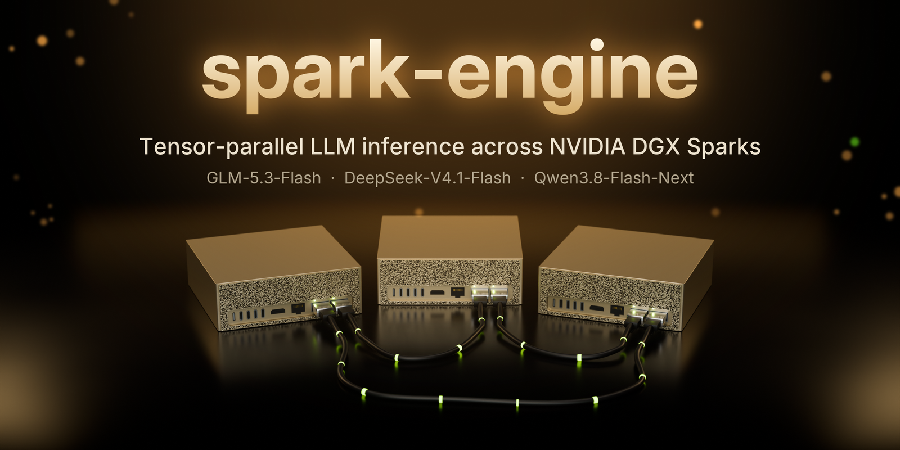

# spark-engine

[中文](README.zh-CN.md)

A from-scratch inference engine for **NVIDIA DGX Spark (GB10, aarch64, CUDA 13 / sm_121)** that serves three large MoE
models through one OpenAI-compatible API, with speculative decoding and 1M-token context:

- **GLM-5.3-Flash** (EXL3 4-bit) across **two or three DGX Sparks** (tensor parallel over the ConnectX-7 RoCE links),
  with the DFlash2 drafter;
- **DeepSeek-V4.1-Flash** (the official MXFP4/FP8 checkpoint, `-1017`) across **three DGX Sparks**, with DSpark
  speculative decoding, Engram tables streamed from NVMe and image input;
- **Qwen3.8-Flash-Next** (EXL3 4-bit) on **one DGX Spark**, with native MTP drafting, image/video input and the full
  hybrid stack.

Everything that matters for performance is the project's own code — the EXL3 GEMM/MoE kernels, the GDN/KDA linear-attention
and sparse-attention kernels, the speculative-decoding state machine, the RDMA all-reduce, FP8 KV, the NVMe prefix cache
and the serving front end. It links only PyTorch's libtorch (tensor plumbing, cuBLAS, NCCL) and the EXL3 dequant kernels.
One binary runs every model; `start.sh glm|glm3|ds41|qwen` picks one.

## At a glance

**How decode is measured** (DeepSeek 2026-10-30, v0.3.9; Qwen 2026-10-29, v0.3.8; the method commonly used for DGX Spark):
`bench/decode_bench.py` against the running server, two prompts — *prose* (a step-by-step explanation of how a hash map
works) and *structured* (count from 1 to 200) — 400 output tokens per request, 1 to 4 concurrent requests (each
concurrent request has a `Request ID: decode-<i>` line before the prompt), median of 5 runs. Every row says its
sampling: **greedy, thinking off** (temperature 0) or **T 1, thinking on** (temperature 1, reasoning tokens counted).
Aggregate = all decode tokens / the window from the first token of the earliest request to the last token of the
latest. GLM's rows are older (2026-10-08, v0.1.1, greedy, thinking off, a `(stream i/n)` suffix instead of the
`Request ID` line). Prefill, TTFT and startup: DeepSeek prefill 2026-10-30, Qwen prefill 2026-10-29, startup 2026-10-28.
More: [docs/benchmarks.md](docs/benchmarks.md), [docs/ds41.md](docs/ds41.md#7-performance). DeepSeek and Qwen were measured
on the updated system of [Test system and GPU clock](#test-system-and-gpu-clock) at default GPU clocks (sustained runs,
clock sampled every second, no throttling recorded); GLM's column is older (DGX OS 7.5.0, GPU clock locked at 2,200 MHz).

| | **GLM-5.3-Flash** | **DeepSeek-V4.1-Flash** | **Qwen3.8-Flash-Next** |
| --- | --- | --- | --- |
| Hardware | 2× DGX Spark (TP2, RoCE); 3× also supported | 3× DGX Spark (TP3, RoCE mesh) | 1× DGX Spark |
| Architecture | 45 layers: KDA linear-attn + MLA/DSA sparse-attn, 288-expert MoE | 40 layers (20 encoder + 20 decoder): compressed sparse attention with a hierarchical indexer, 384-expert top-6 MoE, Engram n-gram tables, mHC | 48 layers: gated-DeltaNet + QSA sparse-attn, 512-expert top-10 MoE, per-layer n-gram |
| **Decode — prose, greedy, thinking off** (1/2/3/4 streams) | 52.9 / 66.5 / 73.3 / 82.9 tok/s | 67.4 / 92.8 / 109.3 / 124.7 tok/s | 68.4 / 98.0 / 122.4 / 139.2 tok/s |
| **Decode — structured, greedy, thinking off** (1/2/3/4 streams) | 92.5 / 119.1 / 158.0 / 168.0 tok/s | 126.6 / 181.9 / 194.8 / 226.0 tok/s | 157.8 / 230.7 / 280.1 / 310.3 tok/s |
| **Decode — prose, T 1, thinking on** (1/2/3/4 streams) | not measured | 57.2 / 82.2 / 95.0 / 105.5 tok/s | 51.2 / 74.3 / 90.9 / 103.8 tok/s |
| **Decode — structured, T 1, thinking on** (1/2/3/4 streams) | not measured | 109.2 / 153.3 / 153.5 / 180.9 tok/s | 122.7 / 78.1 / 100.9 / 108.0 tok/s |
| **Prefill** | ~1,560 tok/s (10K–55K prompts) | ~5,570 tok/s (8K–64K prompts, new text; 4K ~4,760); a decode step at 128K context 27.0 ms; 1M-token context: prefill ~4,540 tok/s, decode ~56 tok/s (1 stream, greedy) | ~2,000 tok/s (13K–77K prompts) |
| **TTFT** (short prompt) | ~370 ms | ~200 ms; 185 ms for a 7K prompt restored from the NVMe prefix cache | ~140 ms |
| **Startup** (load → serving) | ~33 s | ~16 s (cold start, shards read from NVMe) | ~19 s (cold start) |
| Speculative decoding | DFlash2 drafter, tree/chain verify | DSpark (the checkpoint's draft stages), drafts per sequence from a cost model | native MTP + prompt-lookup |

"Prose" = a long explanation (lower draft acceptance); "structured" = counting 1–200 (high acceptance). Decode speed depends on the text
because of speculation.

### Quantization & runtime precision

| Component | GLM-5.3-Flash | DeepSeek-V4.1-Flash | Qwen3.8-Flash-Next |
| --- | --- | --- | --- |
| Routed experts (weights) | EXL3 **4 bpw**, mcg codebook | official **MXFP4** (E2M1 + E8M0 / 32) | EXL3 **4.05 bpw** (head 6, MTP 4), mul1 codebook |
| Dense weights — prefill | source precision (FP16), cuBLAS | official FP8 (32×32 block scales) / BF16, block-scaled tensor-core MMA | source precision |
| Dense weights — decode | **Q8** (int8 + FP32 scale / 128, ~0.67% RMS; lossless 12-bit C12 optional) | official FP8 / BF16, block-scaled GEMV | FP16 (int8 copies optional) |
| Attention compute | MLA/DSA in FP32/TF32; DSA indexer sparse | sparse attention, FP32 accumulate; FP4 indexer, official KV formats | QSA FP32 accumulate; learned sparse selection |
| **KV cache** | **FP8** (e4m3) | official: FP8 window, FP4 compressed global KV | **FP8** (e4m3) |
| Output head | FP16 | BF16 (FP8 copy for drafting only) | 6 bpw |

Precision classes used throughout: **L0** bitwise-identical, **L1** rounding-level (not worse than FP32 ref), **L2**
drafter-only, **L3** lossy by design. The lossy choices (L3) are the FP8 KV cache and GLM's Q8 dense-decode weights;
both are measured equivalent to the reference. Routed experts keep the checkpoint's EXL3 quantization. DeepSeek runs the
official checkpoint's own formats: prefill KL against the official reference 0.0236 vs. a noise floor of 0.0224.

### Context length & concurrency

| | GLM-5.3-Flash | DeepSeek-V4.1-Flash | Qwen3.8-Flash-Next |
| --- | --- | --- | --- |
| Max context (KV budget) | **1,048,576 tokens** | **1,048,576 tokens** | **1,048,576 tokens** |
| KV-cache memory at that budget | ~7.05 GiB / node (11 MLA layers, 7,216 B/token) | ~3.3 GiB / node (1.1 M-token pool) | ~14.0 GiB (12 sparse-attn + MTP, 14,364 B/token) |
| Concurrent sequences (default) | 4 | 4 | 8 |
| Batched speculative verify | yes (sequences share one forward) | yes (up to 4 sequences, then plain batched decode) | yes (up to 8) |
| Prefix reuse | in-memory stores + NVMe persistent cache (`GLM53_PCACHE`) | in-memory stores + NVMe cache (`DS41_PCACHE`, checkpoints every 512 tokens) | multi-turn prompt checkpoints + NVMe cache (`QWEN_PCACHE`) |
| Long context > 262K | — | — | YaRN scaling |

GLM and Qwen are hybrid: most layers are linear/gated attention whose state is fixed-size (does not grow with context),
so a 1M-token window costs only 7–14 GiB of KV. DeepSeek compresses its global KV (one shared KV head, FP4) and keeps
only a 128-token window per layer in FP8. The rest of GB10's 128 GB unified memory holds the weights.

## What this project is

- **Written for GB10 specifically.** Kernels target sm_121's shared-memory and occupancy limits; decode weights are
  tiled so each warp load is one contiguous 512 B (near the ~230–250 GB/s streaming ceiling); CUDA graphs capture every
  decode shape; memory is sized against `MemAvailable` on the shared CPU/GPU address space.
- **Two- and three-node tensor parallelism over RoCE** with the engine's own RDMA all-reduce (fixed summation order,
  bitwise identical to NCCL on two nodes, 12–50 µs), fused into the hyper-connection update that consumes it; on three
  nodes an N-way RDMA all-reduce / reduce-scatter / all-gather over a direct-cabled mesh, links paired by subnet.
- **One code base, one binary, configuration per model**: PDL launches, top-k selection, mHC, the KV pool (CUDA VMM,
  grows in place), the multimodal canvas and the NVMe prefix-cache core are shared by all three models.
- **Deterministic, graph-captured speculative decoding** with exact greedy semantics: KDA state-correction replay, MLA
  shared base states, DSA per-row selection, confidence-truncated draft trees, and prompt-lookup ("copy") drafts.
- **Self-contained MoE**: one templated EXL3 MoE kernel shared by both models (fused persistent decode; grouped
  tensor-core GEMM prefill); no external MoE library.
- **Full multimodal and long-context serving**: image/video through the model's own vision tower, 1M-token KV pool in
  16K granules with LRU, grow-in-place KV ranges, and a persistent NVMe prefix cache.
- **One OpenAI-compatible binary** for both models, with Prometheus metrics and a memory guard for GB10's unified memory.

## Features

**Both models**
- OpenAI-compatible HTTP API: `/v1/chat/completions` (streaming, usage, stop strings, tool calls, reasoning content
  split from the answer), `/v1/completions`, `/v1/models`, `/tokenize`, `/detokenize`, `/health`, and Prometheus
  `/metrics` with vLLM-compatible metric names.
- Concurrent sequences with batched speculative verification (several sequences share one forward), CUDA graphs for
  every decode shape, KV cache in FP8 with a pool sized from free memory.
- Image and video input (OpenAI `image_url`, `video_url`, data URLs, base64, HTTP(S)), encoded by the model's own
  vision tower inside the engine.
- Long context: 1M-token KV budget; prefix reuse across requests.
- Built for GB10's unified memory: weights, KV and scratch are sized against `MemAvailable`, and the launch scripts
  include a memory guard.

**GLM-5.3-Flash (two or three nodes)**
- Tensor parallelism over two DGX Sparks: NCCL over RoCE plus the engine's own RDMA all-reduce for small messages
  (fixed summation order, bitwise identical to NCCL, 12–50 µs per call). Three nodes (`start.sh glm3`): KDA 22/21/21
  heads, routed experts 6/5/5 Hadamard blocks each, sequence-parallel prefill, N-way RDMA (see docs/deploy.md for its
  validation status with the public checkpoint).
- EXL3 4 bpw routed experts (288 per rank) through the engine's MoE kernels: one fused persistent kernel for decode
  (gate/up, SwiGLU, down) and grouped tensor-core GEMMs for prefill, with programmatic dependent launches.
- Dense decode weights as Q8 (int8 + FP32 scale per 128, tiled for 512-byte loads); a lossless 12-bit coding (C12) is
  available; prefill runs dense weights at source precision.
- DFlash2 drafter with tree/chain verification, KDA (linear attention) state correction replay, MLA shared base states,
  DSA sparse-attention selection and confidence-based truncation; copy (prompt-lookup) drafts.
- Persistent prefix cache on NVMe (`GLM53_PCACHE`); fork checkpoints where a prompt branches off a cached sequence.
- Optional abliteration, off by default ([docs/abliteration.md](docs/abliteration.md)): o_proj transplant (`GLM53_ABLIT`), direction ablation (`SPARK_ABLATE`) and conditional clamp (`SPARK_ABLATE_CLAMP`, also for DeepSeek).

**DeepSeek-V4.1-Flash (three nodes)** — recipe: [docs/ds41.md](docs/ds41.md)
- The official checkpoint unchanged (MXFP4 experts, FP8 block-scaled weights), split over three DGX Sparks: attention
  by head groups, experts and the shared expert by the intermediate dimension (exactly balanced), vocabulary by rows.
- Native block-scaled tensor-core MMA (sm_121a) for the MXFP4 MoE and FP8 GEMMs; multi-row GEMVs whose cost barely grows
  with the rows, so batched decode and speculative verification are nearly free.
- CED prefill (decoder runs only the last window), prefill communication overlapped with compute; Engram rows read
  from NVMe with O_DIRECT, prefetched one chunk ahead.
- DSpark speculative decoding with per-sequence draft counts from a cost model; NVMe prefix cache with checkpoints
  every 512 tokens; image input; the official prompt encoding, tool calls and thinking budgets.

**Qwen3.8-Flash-Next (one node)**
- The full hybrid architecture: gated DeltaNet linear attention, sparse attention with an indexer, a 512-expert top-10
  MoE, 4-stream hyper-connections and per-layer n-gram embeddings (memory-mapped from NVMe).
- All EXL3 products (mul1 codebook) on the engine's own kernels; no exllamav3 runtime.
- Native MTP drafts with a 4-bit sub-vocabulary draft head and prompt-lookup drafts, verified in batches of up to 8
  sequences.
- 1M context (YaRN above 262,144 tokens) with a granular KV pool; multi-turn prompt checkpoints at the last message
  boundary (follow-up TTFT about 0.3 s on a 16K conversation); `max_tokens` reserved on demand instead of up front.
- Reasoning effort levels (`reasoning_effort`: none / low / medium / high).

## Quick start (release binary)

Requirements: DGX Spark (GB10) with DGX OS / Ubuntu 24.04, NVIDIA driver with CUDA 13 support, Python 3.12.
GLM-5.3-Flash needs two (or three) DGX Sparks connected by their ConnectX-7 ports, DeepSeek-V4.1-Flash three. Full
instructions: [docs/deploy.md](docs/deploy.md), [docs/ds41.md](docs/ds41.md).

```bash
# 1. the release (same path on every node for GLM / DeepSeek)
sudo mkdir -p /opt/spark-engine && cd /opt/spark-engine
curl -L https://github.com/fly9i/spark-engine/releases/latest/download/spark-engine-linux-aarch64-cu130-sm121.tar.gz | sudo tar xz --strip-components=1

# 2. Python environment: PyTorch 2.13 (CUDA 13.0) for the engine, plus the front end's packages
python3.12 -m venv .venv
.venv/bin/pip install torch==2.13.0 --index-url https://download.pytorch.org/whl/cu130
.venv/bin/pip install jinja2 tokenizers numpy pillow av "huggingface_hub[cli]"

# 3. models (read their licenses first)
PATH=$PWD/.venv/bin:$PATH scripts/download-models.sh qwen /models     # and/or: glm, ds41

# 4. settings, then start
cp spark.env.example spark.env && $EDITOR spark.env
engine-rs/serve/start.sh qwen            # or: glm / glm3 / ds41 (run on the first node; ds41 needs the shard step of docs/ds41.md)

curl http://localhost:8888/v1/chat/completions -H 'Content-Type: application/json' \
  -d '{"messages":[{"role":"user","content":"Hello!"}],"max_tokens":200}'
```

The release asset names carry the version, for example `spark-engine-v0.1.0-linux-aarch64-cu130-sm121.tar.gz`; pick it from
the [releases page](https://github.com/fly9i/spark-engine/releases).

## Build from source

See [docs/build.md](docs/build.md). In short: CUDA 13.0 toolkit, Rust, a Python 3.12 environment with PyTorch 2.13
(cu130), then

```bash
scripts/fetch-deps.sh                                   # pinned third-party sources (torch-sys, NCCL header)
PYTHON=.venv/bin/python scripts/build-exllamav3.sh      # EXL3 GEMM library from exllamav3 v1.4.9 (MIT)
export LIBTORCH=$(.venv/bin/python -c 'import torch, os; print(os.path.dirname(torch.__file__))')
cd engine-rs && cargo build --release                   # -> engine-rs/target/release/spark-engine
```

GitHub Actions builds on an arm64 runner for version tags (and manual runs) and publishes the release archives.

## Test system and GPU clock

The three DGX Sparks (GB10) used for the numbers in this repository, after the system and firmware update of
2026-10-29 (all three identical):

| Component | Version |
| --- | --- |
| DGX OS (`dgx-release`) | 7.6.0 |
| Kernel | 7.0.0-1019-nvidia |
| NVIDIA driver | 580.178.04 |
| CUDA toolkit | 13.0.3 |
| Embedded controller firmware | 0x03000d07 |
| UEFI firmware | 0x02009e0f / 0x00000519 |
| BIOS | 5.36_0ACUM028 |
| GPU VBIOS | 9A.0B.34.00.00 |
| ConnectX-7 firmware | 28.50.1002 |
| NVMe (Samsung MZALC4T0HBL1, stock 4 TB) firmware | NXHB202Q |

Host settings: `vm.compaction_proactiveness = 0`, `vm.watermark_boost_factor = 0`, no swap, deep CPU idle states
disabled (WFI kept). Until 2026-10-29 the nodes ran DGX OS 7.5.0 (kernel 6.17, driver 580.173.02, older EC / UEFI /
ConnectX-7 firmware) and a leftover service locked the GPU clock at 2,200 MHz; the earlier numbers in this repository
were measured that way. In sustained runs of `bench/decode_bench.py` on the updated system (about 11 minutes per
setting, clock sampled every second, no throttling recorded in either) default clocks and the 2,200 MHz lock were within
±5% of each other, greedy 1–2% faster at default clocks.

DeepSeek-V4.1-Flash-1017 (TP3) on the updated system, default clocks and with the clock locked at 2,200 MHz
(`nvidia-smi -lgc 2200`). Same build and settings for both (default settings plus the optional conditional clamp,
`DS41_ABLATE_CLAMP`), same scripts as [docs/ds41.md](docs/ds41.md#7-performance): `bench/ds41_decode_bench.py`
(greedy, thinking off, 256 tokens per stream, aggregate tok/s, median of 3) and `bench/ds41_prefill_bench.py`
(5 samples per size of the same text, median).

| Decode, tok/s | Prose | Structured | Code |
| --- | --- | --- | --- |
| 1 stream, default clocks | **72.3** | **132.1** | **117.6** |
| 1 stream, 2,200 MHz | 70.7 | 129.1 | 112.4 |
| 2 streams, default clocks | **102.2** | **179.5** | **152.3** |
| 2 streams, 2,200 MHz | 102.0 | 175.5 | 150.3 |
| 4 streams, default clocks | **130.0** | **220.0** | **175.4** |
| 4 streams, 2,200 MHz | 122.4 | 214.5 | 171.7 |

| Prefill | 4K | 8K | 16K | 32K | 64K |
| --- | --- | --- | --- | --- | --- |
| Default clocks, tok/s | **4,749** | **5,467** | **5,565** | **5,622** | **5,623** |
| 2,200 MHz, tok/s | 4,602 | 5,258 | 5,385 | 5,425 | 5,425 |
| TTFT, default clocks | 0.94 s | 1.58 s | 3.02 s | 5.91 s | 11.73 s |

Under load the GPUs ran at 2,430–2,530 MHz (median per node) with default clocks, up to 84–89 °C; locked, at
2,184–2,190 MHz, up to 75–84 °C. The 12% higher clock gives 2–4% more decode (decode is bound by memory bandwidth) and
about 3.5% more prefill. The update itself mattered more: at 2,200 MHz, single-stream decode went from 66.4 / 119.3 /
105.2 tok/s on the old system (measured without the clamp, which changes decode speed by less than 1%) to
70.7 / 129.1 / 112.4. If the nodes run hot under sustained load, a cap such as
`nvidia-smi -lgc 300,2400` trades a little speed for temperature; `nvidia-smi -rgc` restores the default.

## Measured by other users

An independent deployment of DeepSeek-V4.1-Flash-1017 on 3× DGX Spark (TP3), measured by its operator on 2026-10-29
with the public release and default engine settings, using the same scripts as [docs/ds41.md](docs/ds41.md#7-performance)
(`bench/ds41_decode_bench.py`: greedy, thinking off, 256 tokens per stream, median of 3; `bench/ds41_prefill_bench.py`).
Our numbers after the 2026-10-29 system update ([Test system and GPU clock](#test-system-and-gpu-clock), default clocks) are in parentheses.

| Streams | Prose | Structured | Code |
| --- | --- | --- | --- |
| 1 | 70.6 (72.3) | 127.9 (132.1) | 113.7 (117.6) |
| 2 | 97.5 (102.2) | 176.0 (179.5) | 142.0 (152.3) |
| 4 | 129.8 (130.0) | 222.3 (220.0) | 173.8 (175.4) |

| Prompt | 4K | 8K | 16K | 32K | 64K |
| --- | --- | --- | --- | --- | --- |
| Prefill, tok/s | 4,659 (4,749) | 5,445 (5,467) | 5,583 (5,565) | 5,666 (5,622) | 5,681 (5,623) |

64K TTFT 11.6 s (ours 11.7 s). Their first measurement on the same machines was much lower (prefill 2,648–3,810
tok/s, context 687,872); it reached these numbers after working through the [FAQ](#faq) below. Before our own update
their numbers were 4–8% above ours, which came from our nodes' older system and locked GPU clock (see the section
above). Results from your own deployment are welcome as an issue.

## FAQ

**The maximum context is below 1,048,576 tokens and changes from restart to restart.**
The KV pool takes what the *tightest* node has left right after loading, so it shows how much memory one node had free
at that moment, not a limit of the engine. Find the node in the rank logs:
`grep -hE 'ds41-mem\].*margin|KV pool' /tmp/spark-ds41-rank*.log` — the smallest number in `ranks [a, b, c] granules`
is the limiting rank, and its `MemAvailable` line shows what it had (about 16 GiB on our rank 0, which still fits
2.2 M tokens). With the engine stopped every node should show more than 100 GiB `MemAvailable`; look for other inference
stacks or containers, dashboards and exporters, files in `/dev/shm`, huge pages and stuck (D-state) processes. Free
them, `echo 3 > /proc/sys/vm/drop_caches` on all nodes and start again. Lowering `DS41_MEM_MARGIN_GB`, turning off the
draft model or changing the start order is not needed.

**Should the front end be started after the engine is ready, so that it does not take memory from the KV pool?**
No. The vision encoder is loaded by the rank 0 engine before the KV pool is sized and is already counted; the front end
(`ds41_server.py`) does not load torch or touch the GPU and uses about 0.7 GB of host memory. Starting both together, as
`start.sh` does, saves about 4 s.

**Prefill (or multi-stream decode) is far below the reference numbers.**
DeepSeek runs its tensor-parallel traffic over the engine's own RDMA links; prefill moves the most data, so a missing
link shows there first. Check, in this order:
1. Links: `grep '\[rdma_arn\]' /tmp/spark-ds41-rank*.log` must list **two** links for every pair of nodes (both PCIe
   functions of each cable); `no RoCE subnet shared` means an address is missing. Then `ibv_devinfo` (ports
   `PORT_ACTIVE`), `ib_write_bw` per pair, and the per-device counters
   (`/sys/class/infiniband/*/ports/1/counters/port_xmit_data`) rising on every device during a prefill.
2. Version and start path: the same binary on all nodes (`sha256sum`), the latest release, started with
   `start.sh ds41` (it sets `DS41_MOE_OUT_MB`, `GLM53_RDMA_ARN_ROWS_PIPE` and `GLM53_COMM_STREAM_PRIO`).
3. Host settings on every node ([docs/deploy.md](docs/deploy.md) §1): `vm.compaction_proactiveness = 0`,
   `vm.watermark_boost_factor = 0`, no swap. One node without them caused random +0.4–1.5 s prefill spikes for us,
   and since all ranks run in lockstep one stalled node slows all of them.
4. Checkpoint and shards on the local NVMe (the Engram rows are read from it during prefill).

**Startup takes longer than about 16 s.**
The ~16 s is engine load (~10 s) plus warm-up (~4 s), on the stock 4 TB NVMe of the DGX Spark (we use the same drive,
reading the shards at about 11.7 GB/s with O_DIRECT); stopping the old model, `drop_caches` and wrappers are not
included. `grep -hE 'loaded in|waited .* for reads|warm-up in' /tmp/spark-ds41-rank*.log` shows where the time goes. If
the read wait dominates, check `current_link_speed` of the drive (`/sys/class/nvme/nvme0/device/`, 32 GT/s expected),
its temperature (`nvme smart-log`) and a direct read (`dd if=<shard> of=/dev/null bs=64M iflag=direct`). Keep
`DS41_LOAD_PREFETCH`, `DS41_DIRECT_LOAD` and `DS41_WARM_DEFER` at their defaults. If loading is fast but the start is
slow, the script was waiting for every node to reach 100 GiB `MemAvailable` after the previous model, or for a slow node.

**My decode numbers differ from the README by a few percent.**
Check the method first: the README table uses `bench/decode_bench.py` (400 tokens, median of 5), the DeepSeek page uses
`bench/ds41_decode_bench.py` (256 tokens, median of 3); both report the aggregate over the wall window, while summing
per-stream rates gives 3–10% more at 2–4 streams. Speculative decoding depends on the text, so 2–4 stream numbers move
by about 5% between runs. On the machine side: no locked GPU clocks (`nvidia-smi -q -d CLOCK`; `nvidia-smi -rgc`
resets them), no services pinning CUDA threads to the A725 cores, same OS / kernel / firmware on all nodes, and cooling
(our GB10s run at 2.4–2.5 GHz under load), and the DGX OS / firmware version (see [Test system and GPU clock](#test-system-and-gpu-clock)).

**A node hangs or reboots.**
GB10 shares one memory between CPU and GPU and has no swap by default; a node that runs out of memory can stop
responding. Keep other workloads off the nodes. A kernel oops / panic (for example a paging-request fault with no
out-of-memory or Xid message) comes from the kernel or firmware, not from a user-space process: align DGX OS and
firmware across the nodes and enable kdump to capture a trace. Processes stuck in D state on the ConnectX-7 (for
example `mstflint` after a cable or module was re-plugged) only clear with a reboot; check the links afterwards.

## Documentation

| Document | Contents |
| --- | --- |
| [docs/deploy.md](docs/deploy.md) | Hardware, installation, model download, two- and three-node setup, start / stop, troubleshooting |
| [docs/ds41.md](docs/ds41.md) | DeepSeek-V4.1-Flash-1017 on three nodes: network, weights, sharding, settings, API notes, performance |
| [docs/build.md](docs/build.md) | Building from source, dependencies, CI |
| [docs/features.md](docs/features.md) | How the engine works: GLM, DeepSeek and Qwen paths, kernels, speculative decoding, memory |
| [docs/configuration.md](docs/configuration.md) | `spark.env`, profiles, the most useful engine and front-end switches |
| [docs/benchmarks.md](docs/benchmarks.md) | How to measure speed, reference numbers |
| [docs/abliteration.md](docs/abliteration.md) | Optional refusal-removal (all mechanisms): what it is, how to enable, risks |

## Models and licenses

This repository contains code only. Models are downloaded separately and keep their own licenses:

| Model | Source | License |
| --- | --- | --- |
| GLM-5.3-Flash EXL3 4 bpw | [brandonmusic/GLM-5.3-Flash-tr3-4bpw](https://huggingface.co/brandonmusic/GLM-5.3-Flash-tr3-4bpw) | see the model card |
| GLM-5.3-Flash SPX1 V1.1 (this project's own quantization) | [fly9i/GLM-5.3-Flash-SPX1-V1.1](https://huggingface.co/fly9i/GLM-5.3-Flash-SPX1-V1.1) | see the model card |
| DFlash2 drafter for GLM | [incoai/GLM-5.3-Flash-DFlash2](https://huggingface.co/incoai/GLM-5.3-Flash-DFlash2) | **CC BY-NC-ND 4.0 (non-commercial)** |
| DeepSeek-V4.1-Flash-1017 | [deepseek-ai/DeepSeek-V4.1-Flash-1017](https://huggingface.co/deepseek-ai/DeepSeek-V4.1-Flash-1017) (`1bae0e10`) | MIT (see the model card) |
| Qwen3.8-Flash-Next EXL3 | [turboderp/Qwen3.8-Flash-Next-exl3](https://huggingface.co/turboderp/Qwen3.8-Flash-Next-exl3) (`4.05bpw_h6_ng6`) | Qwen license (see the model card) |

**GLM-5.3-Flash SPX1 V1.1** ([fly9i/GLM-5.3-Flash-SPX1-V1.1](https://huggingface.co/fly9i/GLM-5.3-Flash-SPX1-V1.1), 156 GB) is the project's own quantization of
GLM-5.3-Flash for this engine: routed experts in EXL3 trellis codes with a per-expert bit width (3–6, 4.0 bpw on
average), the other linear layers in the 6-bit SPX1 format (INT6 + Hadamard rotation, GPTQ). Eval KL vs. the official
FP8 model 0.0171 (the uniform 4 bpw EXL3 checkpoint: 0.0231). Point `GLM_MODEL` at it; the engine detects the SPX1
tensors (`*.spx_q`) and loads them in place of the originals. (The GLM TP3 numbers in [docs/deploy.md](docs/deploy.md)
were measured with a later, unpublished V1.2 revision of it.) The DFlash2 drafter is downloaded separately as for the EXL3 checkpoint.

Third-party software used at build or run time is listed in [THIRD_PARTY.md](THIRD_PARTY.md).

## License

[MIT](LICENSE).
